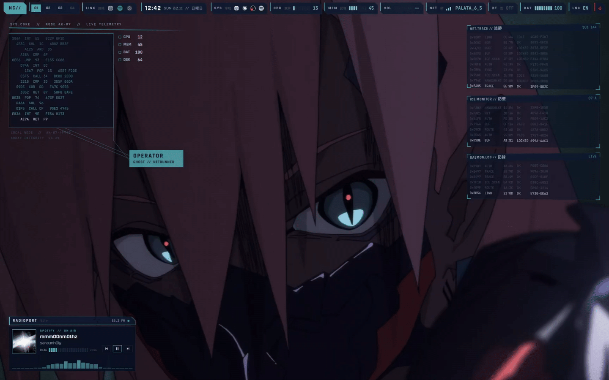
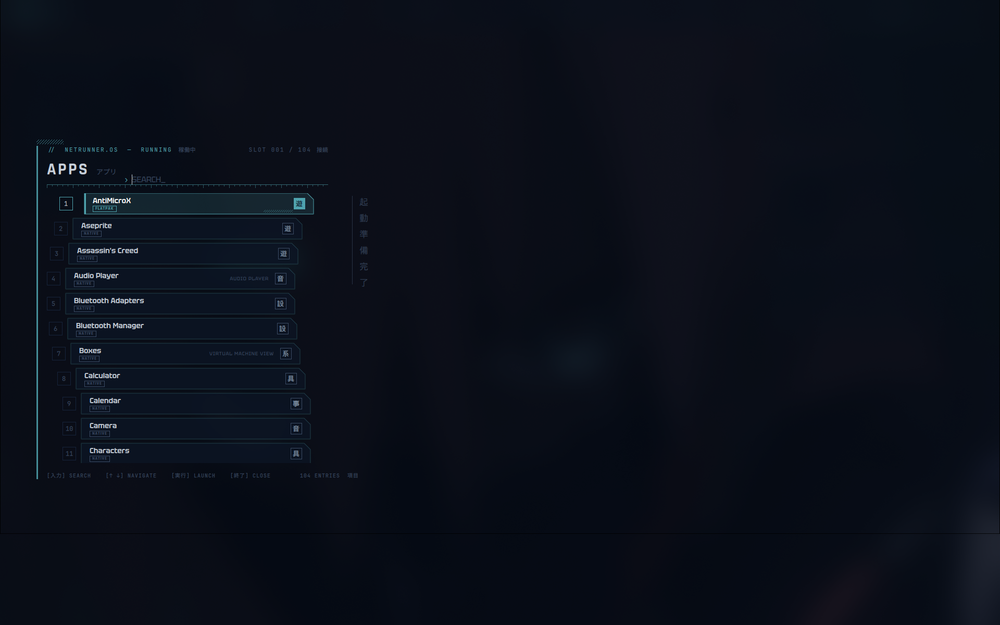
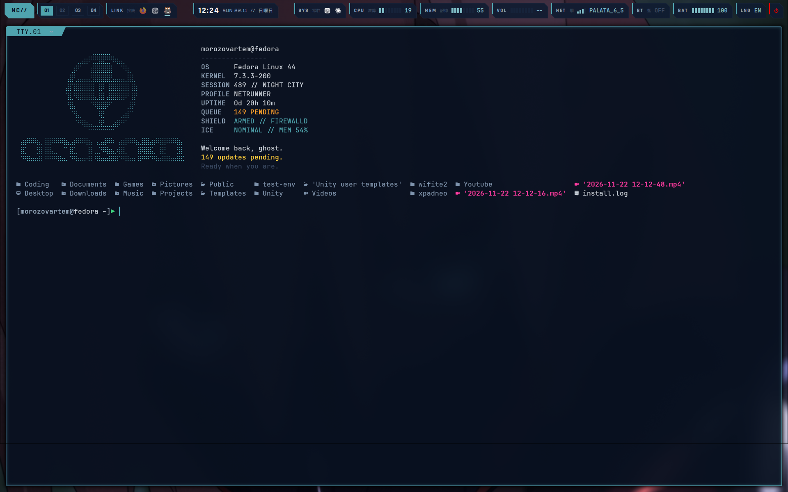
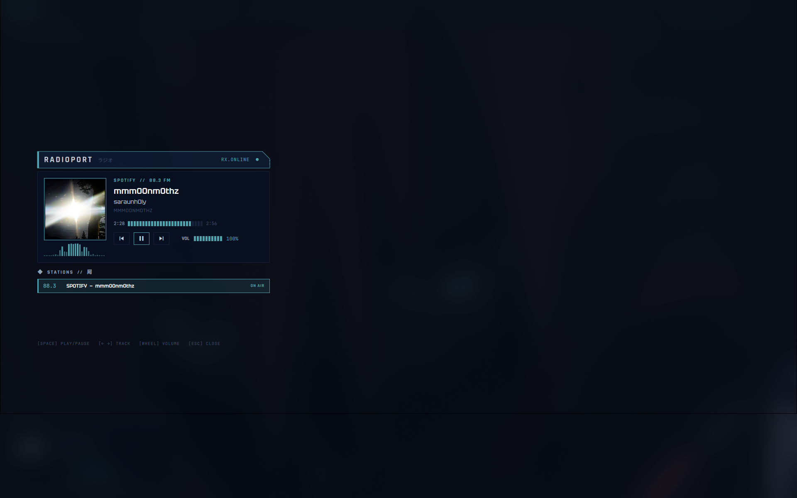

# kiroshi-shell

**A Cyberpunk 2077 / Edgerunners style desktop for Fedora: Hyprland + a custom Quickshell HUD.**
Muted navy and teal instead of loud neon, chamfered plates, kanji labels, a numbered app list,
a live telemetry desktop. Everything is one-command installable and reversible.



| Launcher (`Super+D`) | Terminal greeting |
| --- | --- |
|  |  |



## What you get

- **Top bar** (Quickshell): workspaces, window list, clock with kanji weekday, tray, CPU / MEM / VOL / NET / BT / BAT readouts. Click a readout to open its panel.
- **App launcher**: numbered list with a staircase offset and a category kanji on every row, search, smooth scrolling.
- **Panels**: Wi-Fi, Bluetooth, audio mixer, notification history, power menu, window switcher, volume and brightness OSD.
- **RADIOPORT**: media player card (MPRIS) on the desktop and a full popup.
- **Desktop HUD**: scrolling diagnostics and live system telemetry on an empty workspace; they fade out when a window opens.
- **Lock screen** (hyprlock) and idle handling (hypridle).
- **Terminal**: kitty, fish, starship, fastfetch with a dot-matrix logo, eza / zoxide / fzf, Yazi file manager.
- **Optional**: Firefox theme and HUD start page, VS Code theme, Spotify (Spicetify) theme with a "warm start" toggle.
- **Safety net**: the installer backs up what it replaces, `uninstall.sh` restores it, and `rice-snapshot` / `rice-restore` let you save and roll back your own tweaks.

## Requirements

- Fedora 44 (other Fedora versions may work, nothing else is tested).
- A Hyprland build with the **Lua config** (0.57+). The installer enables the `sdegler/hyprland` COPR for it.
- A GPU and driver that Hyprland supports; a 1080p or 1200p laptop panel is what it was built on.

## Install

```bash
git clone https://github.com/cdmorozov/kiroshi-shell.git
cd kiroshi-shell
./install.sh --dry-run        # see what it would do
./install.sh --all            # everything: packages, fonts, configs, Firefox, VS Code, Spotify
```

Smaller variants:

```bash
./install.sh                          # core desktop only
./install.sh --firefox --vscode       # add themes you want
./install.sh --no-packages            # you already installed the dependencies
```

Then log out, choose **Hyprland** from the gear menu on the login screen and sign in.
Your old configs are in `~/.netrunner-backup-<date>`; `./uninstall.sh` restores them.

## Keys

| Key | Action |
| --- | --- |
| `Super+D` / `Super+R` | app launcher |
| `Super+Enter` / `Super+T` | terminal |
| `Super+Tab` | window switcher |
| `Super+E` | Yazi (files in the terminal), `Super+Alt+E` Nautilus |
| `Super+W` / `Super+B` / `Super+A` | Wi-Fi / Bluetooth / audio panels |
| `Super+M` | RADIOPORT player |
| `Super+N` | notification history, `Super+Shift+N` dismiss toasts |
| `Super+Esc` | power menu |
| `Super+L` | lock screen |
| `Super+I` | system settings |
| `Super+Shift+V` | clipboard history |
| `Super+Q` / `Super+F` / `Super+V` | close / fullscreen / toggle floating |
| `Super+1..0` | workspaces (`+Shift` moves the window) |
| `Super+S` | scratchpad |
| `Super+Shift+M` | show / hide Spotify (needs `--spotify`) |
| `Print` | screenshot a region to the clipboard |
| `Super+Shift+E` | emergency exit to the login screen |

## Make it yours

- **Wallpaper**: set it in *GNOME Settings > Appearance > Background*. `wallpaper-sync` copies the choice to hyprpaper and to the lock screen.
- **Colours**: every shell colour lives in `~/.config/quickshell/Theme.qml`. Hyprland borders are in `hyprland.lua`.
- **Fonts**: Rajdhani for labels, Tektur for text with Cyrillic, JetBrainsMono Nerd Font for code. Change them in `Theme.qml` and `kitty.conf`.
- **Monitors**: `hl.monitor(...)` in `hyprland.lua`. Scale is 1 by default.
- **Snapshots**: `rice-snapshot before-experiment`, then `rice-restore before-experiment` if you do not like the result.

## Layout of this repo

```
config/        everything that lands in ~/.config (hypr, quickshell, kitty, fish, ...)
bin/           helper scripts installed to ~/.local/bin
firefox/       userChrome.css, userContent.css, user.js
vscode/        the "Night City HUD" colour theme
assets/        a generated placeholder wallpaper
install.sh     installer          uninstall.sh   restores the backup
```

## Credits

- Inspired by the Cyberpunk 2077 interface and by [CyberArch-Shell](https://github.com/ARCANGEL0/CyberArch-Shell) and the r/unixporn Cyberpunk rices.
- Built on [Hyprland](https://hyprland.org), [Quickshell](https://quickshell.org), [Yazi](https://github.com/sxyazi/yazi), [Spicetify](https://spicetify.app).
- Fonts are downloaded by the installer from their upstream projects: Rajdhani and Tektur (SIL OFL, Google Fonts), JetBrainsMono Nerd Font.

## Disclaimer

This is an unofficial fan project. *Cyberpunk 2077*, *Edgerunners* and *Arasaka* belong to CD PROJEKT S.A. and
Studio Trigger. No game files are included: the interface is original code, and the Arasaka-style emblem is a fan-made recreation.
Provided as is, under the MIT license. Read `install.sh` before you run it: it uses `sudo` for packages.
