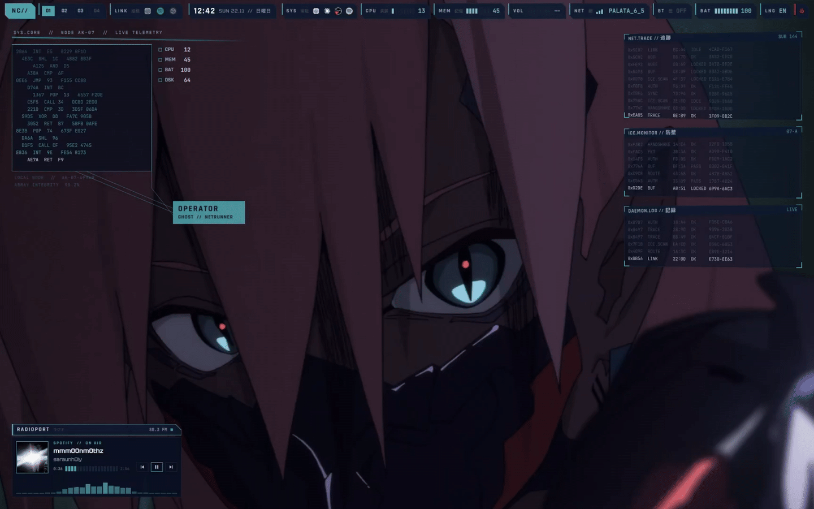
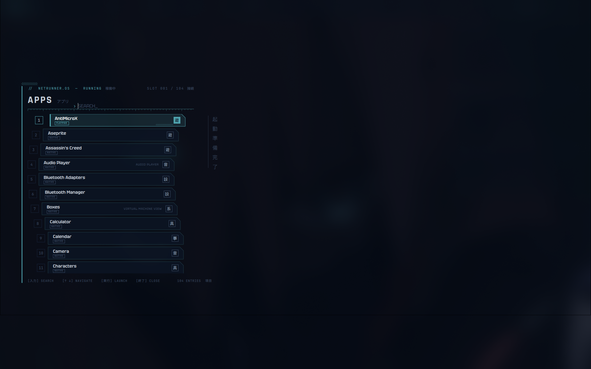
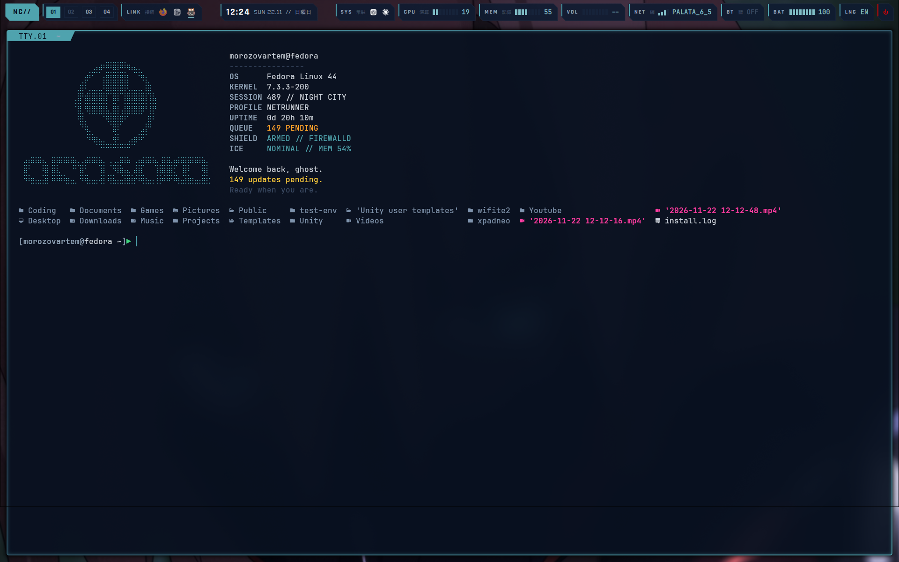
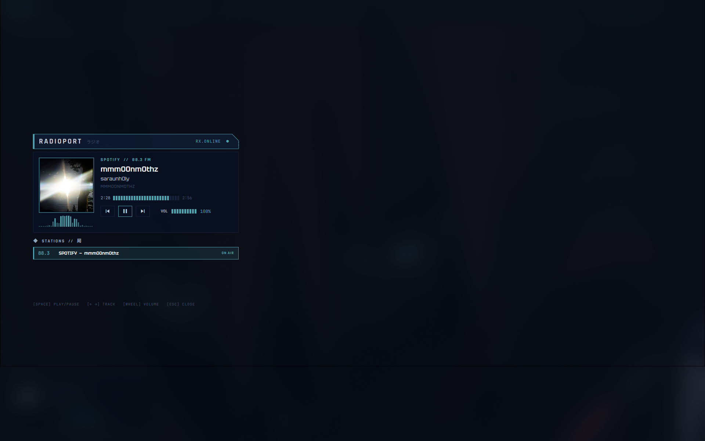

# kiroshi-shell

**Рабочий стол для Fedora в стиле Cyberpunk 2077 / Edgerunners: Hyprland и собственный HUD на Quickshell.**
Приглушённые синий и бирюзовый вместо кричащего неона, плашки со срезанными углами, подписи иероглифами,
нумерованный список приложений и живая телеметрия на рабочем столе. Ставится одной командой и откатывается назад.

[English version](README.md)



| Лаунчер (`Super+D`) | Терминал |
| --- | --- |
|  |  |



## Что внутри

- **Верхняя панель**: рабочие столы, список окон, часы с иероглифом дня недели, трей, показания CPU / MEM / VOL / NET / BT / BAT. Клик по показанию открывает его панель.
- **Меню приложений**: нумерованный список со ступенчатым сдвигом, иероглиф категории на каждой строке, поиск, плавная прокрутка.
- **Панели**: Wi-Fi, Bluetooth, микшер звука, история уведомлений, меню питания, переключатель окон, индикаторы громкости и яркости.
- **RADIOPORT**: карточка плеера (MPRIS) на рабочем столе и большое окно.
- **HUD на рабочем столе**: бегущая диагностика и живая телеметрия на пустом рабочем столе; при открытии окна гаснут.
- **Экран блокировки** (hyprlock) и автоблокировка (hypridle).
- **Терминал**: kitty, fish, starship, fastfetch с логотипом из точек, eza / zoxide / fzf, файловый менеджер Yazi.
- **По желанию**: тема Firefox и стартовая страница, тема VS Code, тема Spotify (Spicetify) с «тёплым стартом».
- **Страховка**: установщик делает копию того, что заменяет, `uninstall.sh` возвращает её, а `rice-snapshot` и `rice-restore` сохраняют и откатывают ваши собственные правки.

## Требования

- **Hyprland 0.55 или новее** (конфиг написан на Lua) и **Quickshell**. Это жёсткое требование для любого дистрибутива.
- Поддержка дистрибутивов:

| Дистрибутив | Статус | Откуда берётся Hyprland |
| --- | --- | --- |
| **Fedora 44** | проверено, на нём всё и делалось | COPR `sdegler/hyprland`, установщик подключает сам |
| Fedora 43 и старше | ставятся терминал, fish, Quickshell и конфиги; Hyprland 0.55+ под них не собран, для рабочего стола обновитесь до 44 | COPR `errornointernet/quickshell` |
| **Debian testing / sid, Kali Linux (rolling)** | экспериментально, автор не проверял | в Kali rolling есть `hyprland` 0.56 и `quickshell` 0.3 (проверено по индексу пакетов), в Debian testing/sid 0.57. На Debian 13 берите `trixie-backports` (Hyprland 0.55) |
| **Arch, CachyOS, EndeavourOS** | экспериментально, автор не проверял | оба пакета есть в официальных репозиториях |
| Ubuntu и остальные | пока не поддерживаются | Hyprland и Quickshell нужно собрать или поставить вручную |

На экспериментальных установщик ставит пакеты по одному и выводит те, которых нет в ваших репозиториях, поэтому один отсутствующий пакет не останавливает остальные.
Pull request с исправлением под ваш дистрибутив приветствуется.

**Заметки про Kali Linux.** Ставьте под обычным пользователем (не root). Стандартный экран входа Kali (LightDM) не показывает Wayland-сессии: поставьте `gdm3` или `sddm`, либо войдите в текстовую консоль и наберите `Hyprland`.
В виртуальной машине Hyprland нужно рабочее 3D-ускорение, там он часто тормозит или не запускается, поэтому лучше установка на железо или проброс видеокарты.
- Видеокарта и драйвер, которые поддерживает Hyprland. Делалось на ноутбучной матрице 1920×1200.

## Установка

```bash
git clone https://github.com/cdmorozov/kiroshi-shell.git
cd kiroshi-shell
./install.sh --dry-run        # посмотреть, что будет сделано
./install.sh --all            # всё: пакеты, шрифты, конфиги, Firefox, VS Code, Spotify
```

Варианты поменьше:

```bash
./install.sh                          # только основной рабочий стол
./install.sh --firefox --vscode       # добавить нужные темы
./install.sh --no-packages            # зависимости уже стоят
```

Потом выйдите из сессии, выберите **Hyprland** в меню с шестерёнкой на экране входа и войдите.
Старые конфиги лежат в `~/.netrunner-backup-<дата>`, `./uninstall.sh` вернёт их.

## Клавиши

| Клавиши | Действие |
| --- | --- |
| `Super+D` / `Super+R` | меню приложений |
| `Super+Enter` / `Super+T` | терминал |
| `Super+Tab` | переключатель окон |
| `Super+E` | Yazi (файлы в терминале), `Super+Alt+E` Nautilus |
| `Super+W` / `Super+B` / `Super+A` | панели Wi-Fi / Bluetooth / звук |
| `Super+M` | плеер RADIOPORT |
| `Super+N` | история уведомлений, `Super+Shift+N` убрать всплывшие |
| `Super+Esc` | меню питания |
| `Super+L` | блокировка |
| `Super+I` | системные настройки |
| `Super+Shift+V` | история буфера обмена |
| `Super+Q` / `Super+F` / `Super+V` | закрыть / на весь экран / плавающее окно |
| `Super+1..0` | рабочие столы (`+Shift` переносит окно) |
| `Super+S` | скретчпад |
| `Super+Shift+M` | показать / спрятать Spotify (нужен `--spotify`) |
| `Print` | скриншот области в буфер |
| `Super+Shift+E` | аварийный выход на экран входа |

## Под себя

- **Обои**: поставьте в *Настройки GNOME > Внешний вид > Фон*. `wallpaper-sync` перенесёт выбор в hyprpaper и на экран блокировки.
- **Цвета**: все цвета оболочки в `~/.config/quickshell/Theme.qml`, рамки окон в `hyprland.lua`.
- **Шрифты**: Rajdhani для подписей, Tektur для текста с кириллицей, JetBrainsMono Nerd Font для кода. Меняются в `Theme.qml` и `kitty.conf`.
- **Мониторы**: `hl.monitor(...)` в `hyprland.lua`. Масштаб по умолчанию 1.
- **Снимки**: `rice-snapshot before-experiment`, а если результат не понравился, `rice-restore before-experiment`.

## Что где лежит

```
config/        всё, что попадает в ~/.config (hypr, quickshell, kitty, fish, ...)
bin/           скрипты, которые ставятся в ~/.local/bin
firefox/       userChrome.css, userContent.css, user.js
vscode/        цветовая тема «Night City HUD»
assets/        сгенерированные обои-заглушка
install.sh     установщик          uninstall.sh   возвращает копию
```

## Благодарности

- Вдохновлено интерфейсом Cyberpunk 2077, а также [CyberArch-Shell](https://github.com/ARCANGEL0/CyberArch-Shell) и ригами с r/unixporn.
- Построено на [Hyprland](https://hyprland.org), [Quickshell](https://quickshell.org), [Yazi](https://github.com/sxyazi/yazi), [Spicetify](https://spicetify.app).
- Шрифты установщик скачивает у авторов: Rajdhani и Tektur (SIL OFL, Google Fonts), JetBrainsMono Nerd Font.

## Оговорка

Это неофициальный фанатский проект. *Cyberpunk 2077*, *Edgerunners* и *Arasaka* принадлежат CD PROJEKT S.A. и
Studio Trigger. Файлов игры здесь нет: интерфейс написан с нуля, а эмблема в стиле Arasaka воссоздана фанатами.
Лицензия MIT, без гарантий. Прочитайте `install.sh` перед запуском: для пакетов он использует `sudo`.
